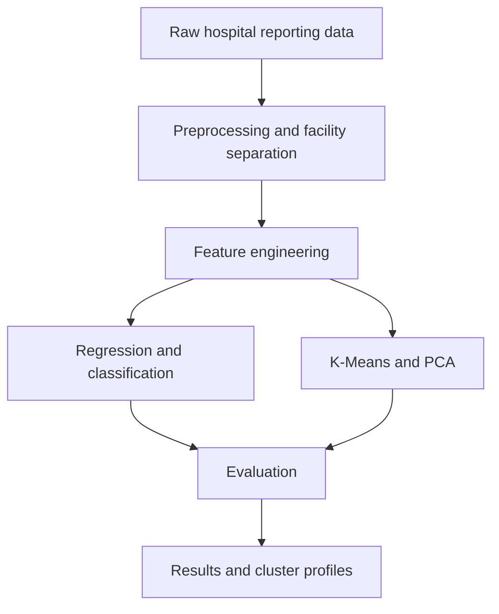

# Hospital Performance & Resource Optimization

**Project collaborators: Abhinav Varma & Devika Rani Sanaboyina — UMBC DATA 602.**

## Original Project

The original coursework introduced this as a machine learning analysis of hospital performance using Medicare data. The underlying source is California HCAI/OSHPD hospital financial reporting data, including Medicare-related measures. Using Python, Pandas, and the CRISP-DM framework, the project explores capacity and spending patterns through regression, classification, and clustering.

The 2012–2017 extract contains **578,350 reporting rows across 472 facilities and 2,690 reporting periods**. Each row represents one measure for a facility period. `Amount` can mean dollars, counts, hours, or ratios depending on `Variable`.

Follow the original notebooks in this order:

1. **[602_Regression_Model_Abhinav&Devika.ipynb](602_Regression_Model_Abhinav%26Devika.ipynb)** — Start with data cleaning, missing-value handling, feature selection, and regression models. This notebook creates `cleaned_hospital_data.csv` for the next stage. The original README described readmission-score prediction; the code actually predicts the reported `Amount` field.
2. **[602_Clustering_&_Classification_Model_Abhinav&Devika.ipynb](602_Clustering_%26_Classification_Model_Abhinav%26Devika.ipynb)** — Use the cleaned data to explore hospital groupings and classification after selected outlier removal. Compare it with the full-data classification notebook to examine differences across data conditions.
3. **[602_Classification_Model_Abhinav&Devika.ipynb](602_Classification_Model_Abhinav%26Devika.ipynb)** — Compare classification models on the original data with outliers retained, providing a full-data benchmark.

The [executive summary](602%20executive%20%20summary%20-%20%20Devika%20%20%26%20Abhinav.pdf) covers the goals, methods, and outcomes. The [final presentation](DATA%20602%20FINAL%20PROJECT%20PPT%5B1%5D.pdf) presents the workflow, models, and evaluation metrics. All original notebooks, PDFs, and saved results remain unchanged, with both collaborators credited.

## Improvements

The added workflows use traditional machine learning to describe capacity patterns and estimate reported operating expenses:

- **Preprocessing and features:** Retain facility IDs and dates, remove only exact full-schema duplicates, and learn missing-value imputation, scaling, category encoding, and predictor clipping from training data. COUNTY uses one-hot encoding; facility IDs are used for validation groups.
- **Facility-aware validation:** Keep every facility in one partition so related reports cannot appear in both training and testing. Model comparisons use three grouped development folds, followed by a separate holdout.
- **Consistent clustering inputs:** K-Means and PCA use the same capacity feature matrix: log licensed beds, available/licensed beds, and staffed/available beds. These describe size and availability without repeatedly weighting three correlated bed counts. PCA provides a two-dimensional view of that matrix.
- **Cluster checks:** Compare K=2..8 using silhouette scores, repeated initializations, and five whole-facility bootstrap refits to check how much the groupings change.
- **Model comparisons:** Use `TOT_OP_EXP` (total operating expenses) for a consistent financial target. Compare regression and expense-category classification with simple baselines, retain target extremes, and report uncertainty and sensitivity to predictor clipping.

Clustering excludes mixed-unit `Amount`. Classification means expense above a training-derived median; it does not measure demand or hospital efficiency. See [methods](docs/METHODS.md) and [data provenance](docs/DATA_PROVENANCE.md) for feature definitions and validation details.

## Architecture & Workflow



Preprocessing learns from training facilities only. Evaluation compares predictions with baselines and checks cluster separation and stability. Results include metrics, capacity profiles, and PCA plots.

The added notebooks can each run independently after fetching the input; their suggested reading order is:

| Notebook | Purpose |
| --- | --- |
| [01_data_audit](notebooks/01_data_audit.ipynb) | Source checks, missing values, reporting units, and capacity exploration |
| [02_capacity_clustering](notebooks/02_capacity_clustering.ipynb) | K-Means, K selection, stability, PCA, and cluster profiles |
| [03_supervised_evaluation](notebooks/03_supervised_evaluation.ipynb) | Expense regression and classification with grouped validation and baselines |
| [04_historical_replay](notebooks/04_historical_replay.ipynb) | Separate execution of the original cleaning and clustering workflow |

## Results

The added analysis uses **377 development facilities and 95 held-out facilities**, with no overlap. Capacity clustering fits one vector per reporting period, then assigns its cluster to the associated reporting rows. Random Forest was selected for both supervised tasks using development-fold results.

| Evaluation | Verified result |
| --- | --- |
| Selected K | 3 |
| Development / held-out silhouette | 0.407 / 0.445 |
| Mean bootstrap cluster agreement (ARI) at K=3 | 0.965 |
| Expense regression holdout MAE | $100.2M vs $150.9M median baseline |
| Expense regression holdout RMSE / R² | $166.5M / 0.319 |
| Expense classification balanced accuracy | 0.790 vs 0.500 baseline |
| Expense classification ROC-AUC / average precision | 0.850 / 0.812; positive prevalence 0.513 |

These are capacity and expense patterns, not verified efficiency rankings or clinical outcomes. Licensed beds are measured at period end, while available and staffed beds are period averages, so their ratios need context. Results use historical, unadjusted dollar values and same-period predictors; they do not establish future forecasting performance. Clipping did not improve every model, and the regression R² uncertainty interval includes negative values.

See [detailed results and limitations](docs/RESULTS.md) for uncertainty intervals, outlier sensitivity, and links to the underlying reports. Original coursework scores remain separate because their targets and validation differ.

## How to Run

Tested with **Python 3.11.17 on Linux**. From the repository root:

```bash
python3.11 -m venv .venv
source .venv/bin/activate
python -m pip install -r requirements-lock.txt
python scripts/fetch_data.py --historical-cleaned
python scripts/execute_notebooks.py
python scripts/verify_artifacts.py --with-data
python -m pytest -q
```

On Windows, activate with `.venv\Scripts\Activate.ps1`. The execution script runs the four added notebooks in fresh kernels. For the original coursework, follow the three-notebook order above; its downloads and Colab-specific cells are preserved as submitted.

`requirements.txt` lists direct dependencies; `requirements-lock.txt` records the tested environment. Source CSVs are excluded from Git; the [source manifest](data/source_manifest.json) records download locations and fingerprints. If the optional coursework cleaned-file link is unavailable, fetch only the raw source with `python scripts/fetch_data.py`.

Saved metrics, profiles, and figures are under [reports](reports), with execution details in the [execution manifest](reports/execution_manifest.json). GitHub Actions runs offline checks and offers an optional manual notebook-execution job.
